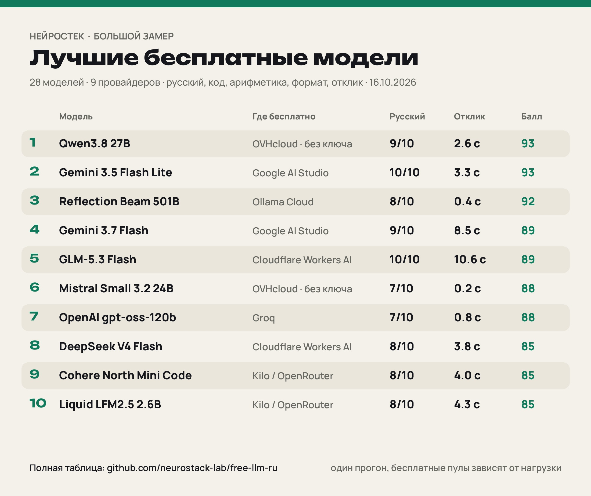

# Бесплатные LLM API: что реально работает (замер 16.10.2026)

Мы прошлись по провайдерам с бесплатным доступом к языковым моделям и прогнали каждую доступную модель одним и тем же набором тестов для русскоязычного пользователя.
**Итог:** заработало 28 моделей (рабочих связок модель+провайдер — 31); ещё 12 бесплатно получить не удалось.

Сделано каналом [НейроСтек](https://t.me/neurostack_news). Набор заданий — тот же, что в нашем [ollama-ru-bench](https://github.com/neurostack-lab/ollama-ru-bench); для OpenAI-совместимых провайдеров мы использовали его расширенную внутреннюю версию.

## Рейтинг (лучший провайдер для каждой модели)

Балл из 100: русский 40 (оценка судьи 1–10, медиана трёх оценок), код 25 (функция на настоящих автотестах), арифметика 10, формат ответа 10, отклик 15 (время до первого токена).

| # | Модель | Где бесплатно | Балл | Русский | Код | Арифм. | Формат | Первый токен |
|---|---|---|---|---|---|---|---|---|
| 1 | Qwen3.8 27B | OVHcloud (без ключа) | 93.0 | 9/10 | 3/3 | ✓ | ✓ | 2.6 с |
| 2 | Gemini 3.5 Flash Lite | Google AI Studio | 93.0 | 10/10 | 3/3 | ✓ | ✓ | 3.27 с |
| 3 | Reflection Beam 501B | Ollama Cloud | 92.0 | 8/10 | 3/3 | ✓ | ✓ | 0.44 с |
| 4 | Gemini 3.7 Flash | Google AI Studio | 89.0 | 9/10 | 3/3 | ✓ | ✓ | 8.54 с |
| 5 | GLM-5.3 Flash | Cloudflare Workers AI | 89.0 | 10/10 | 3/3 | ✓ | ✓ | 10.58 с |
| 6 | Mistral Small 3.2 24B | OVHcloud (без ключа) | 88.0 | 7/10 | 3/3 | ✓ | ✓ | 0.19 с |
| 7 | OpenAI gpt-oss-120b | Groq | 88.0 | 7/10 | 3/3 | ✓ | ✓ | 0.79 с |
| 8 | DeepSeek V4 Flash | Cloudflare Workers AI | 85.0 | 8/10 | 3/3 | ✓ | ✓ | 3.84 с |
| 9 | Cohere North Mini Code | Kilo / OpenRouter | 85.0 | 8/10 | 3/3 | ✓ | ✓ | 4.05 с |
| 10 | Liquid LFM2.5 2.6B | Kilo / OpenRouter | 85.0 | 8/10 | 3/3 | ✓ | ✓ | 4.27 с |
| 11 | NVIDIA Nemotron 3.5 Super VL | Kilo / OpenRouter | 85.0 | 8/10 | 3/3 | ✓ | ✓ | 5.62 с |
| 12 | NVIDIA Nemotron 3 Super 120B | Kilo / OpenRouter | 85.0 | 8/10 | 3/3 | ✓ | ✓ | 6.04 с |
| 13 | StepFun Step 5 Preview | NVIDIA NIM | 85.0 | 8/10 | 3/3 | ✓ | ✓ | 9.7 с |
| 14 | Qwen3.5 397B | OVHcloud (без ключа) | 85.0 | 9/10 | 3/3 | ✓ | ✓ | 14.76 с |
| 15 | Google Gemma 4 26B A4B | Cloudflare Workers AI | 85.0 | 9/10 | 3/3 | ✓ | ✓ | 19.3 с |
| 16 | Mistral Small 3.1 24B | Cloudflare Workers AI | 84.0 | 6/10 | 3/3 | ✓ | ✓ | 0.3 с |
| 17 | OpenAI gpt-oss-20b | Groq | 84.0 | 6/10 | 3/3 | ✓ | ✓ | 0.49 с |
| 18 | Llama 4 Scout | Cloudflare Workers AI | 81.0 | 6/10 | 3/3 | ✓ | ✓ | 2.06 с |
| 19 | Dots3-Note Preview | Kilo / OpenRouter | 81.0 | 7/10 | 3/3 | ✓ | ✓ | 3.06 с |
| 20 | Meta Muse Glimmer 30B | NVIDIA NIM | 81.0 | 8/10 | 3/3 | ✓ | ✓ | 29.77 с |
| 21 | Qwen3.5 9B | OVHcloud (без ключа) | 81.0 | 9/10 | 3/3 | ✓ | ✓ | 42.55 с |
| 22 | Gemini 3.8 Flash | Google AI Studio | 81.0 | 9/10 | 3/3 | ✓ | ✓ | 105.94 с |
| 23 | GLM-5.3 | NVIDIA NIM | 81.0 | 9/10 | 3/3 | ✓ | ✓ | 228.85 с |
| 24 | Llama 3.3 70B | Cloudflare Workers AI | 78.0 | 7/10 | 3/3 | ✗ | ✓ | 0.41 с |
| 25 | Poolside Laguna S 2.1 | Kilo / OpenRouter | 75.0 | 7/10 | 3/3 | ✗ | ✓ | 1.22 с |
| 26 | NVIDIA Nemotron 3.5 Lightning | Kilo / OpenRouter | 73.0 | 6/10 | 3/3 | ✓ | ✓ | 18.78 с |
| 27 | GLM-4.5 Flash | Z.ai | 71.0 | 8/10 | 3/3 | ✗ | ✓ | 10.12 с |
| 28 | GLM-4.7 Flash | Z.ai | 67.0 | 7/10 | 3/3 | ✓ | ✗ | 11.15 с |

## Одна модель — разные провайдеры

| Модель | Провайдер | Русский | Первый токен | ток/с |
|---|---|---|---|---|
| Qwen3.8 27B | Groq | 8/10 | 0.13 с | 287.0 |
| Qwen3.8 27B | OVHcloud (без ключа) | 9/10 | 2.6 с | 107.7 |
| GLM-5.3 Flash | Cloudflare Workers AI | 10/10 | 10.58 с | 36.3 |
| GLM-5.3 Flash | NVIDIA NIM | 8/10 | 132.18 с | 3.5 |
| OpenAI gpt-oss-120b | Groq | 7/10 | 0.79 с | 349.3 |
| OpenAI gpt-oss-120b | OVHcloud (без ключа) | 8/10 | 9.83 с | 29.3 |

## Где брать бесплатный доступ

| Провайдер | Что нужно | Лимиты | Что там хорошего |
|---|---|---|---|
| [OVHcloud AI Endpoints](https://endpoints.ai.cloud.ovh.net) | без ключа и регистрации | 2 запроса/мин на модель | Qwen3.8 27B, Qwen3.5 397B, gpt-oss-120b, Mistral Small 3.2 |
| [Kilo Gateway](https://kilo.ai) | без ключа | 200 запросов/час на IP | бесплатные модели OpenRouter (Nemotron, LFM, Cohere North) |
| [Google AI Studio](https://aistudio.google.com/apikey) | ключ, без карты | лимиты в AI Studio; бесплатно только Flash/Flash Lite | Gemini 3.5 Flash Lite, 3.7/3.8 Flash |
| [Groq](https://console.groq.com/keys) | ключ, без карты | 30 запросов/мин, 1000/день на модель | gpt-oss-120b/20b, Qwen3.8 27B |
| [Cloudflare Workers AI](https://developers.cloudflare.com/workers-ai/) | аккаунт Cloudflare | 10 000 «нейронов» в день | GLM-5.3 Flash, DeepSeek V4 Flash, Gemma 4, Llama |
| [OpenRouter](https://openrouter.ai/keys) | ключ, без карты | 20 запросов/мин, 50/день (1000 после пополнения на $10) | модели с суффиксом :free |
| [Ollama Cloud](https://ollama.com) | аккаунт; часть моделей бесплатно временно | у Beam — бесплатно на ограниченное время | Reflection Beam |
| [NVIDIA NIM](https://build.nvidia.com) | ключ; нужно подтвердить телефон (российские номера не принимает) | ~40 запросов/мин | StepFun Step 5, GLM-5.3, Muse Glimmer — часть каталога не запускается |
| [Z.ai](https://z.ai) | ключ, без карты | GLM Flash бесплатно, в часы пик тормозит | GLM-4.5/4.7 Flash |

## Не получилось бесплатно

- **DeepSeek V4.1 Flash**: NVIDIA NIM — не ответила за 5 минут
- **Gemini 2.5 Flash**: Google AI Studio — недоступна новым пользователям
- **Gemini 3.1 Pro**: Google AI Studio — нулевая бесплатная квота
- **Gemini 4 Argon**: Google AI Studio — нулевая бесплатная квота
- **Gemma 4 31B**: Google AI Studio — ошибка на стороне провайдера; NVIDIA NIM — не ответила за 5 минут; OpenRouter — лимит бесплатного пула
- **Kimi K2.6**: NVIDIA NIM — есть в каталоге, но не запускается
- **Mistral Large**: NVIDIA NIM — есть в каталоге, но не запускается
- **NVIDIA Nemotron 3 Nano Omni 30B**: Kilo / OpenRouter — лимит бесплатного пула; OpenRouter — лимит бесплатного пула
- **NVIDIA Nemotron 3 Ultra 550B**: Kilo / OpenRouter — не ответила за 5 минут; NVIDIA NIM — есть в каталоге, но не запускается; OpenRouter — есть в каталоге, но не запускается
- **Poolside Laguna XS 2.1**: Kilo / OpenRouter — лимит бесплатного пула; OpenRouter — лимит бесплатного пула
- **Thinking Machines Inkling**: Kilo / OpenRouter — есть в каталоге, но не запускается; OpenRouter — только внутри агентных сред
- **Thinking Machines Inkling Small**: Kilo / OpenRouter — лимит бесплатного пула; OpenRouter — только внутри агентных сред

- SambaNova — на 16.10.2026 просит карту при регистрации
- Cerebras — бесплатного уровня нет, только пробные $5 с картой
- Mistral La Plateforme — бесплатный API только после подтверждения по SMS (у нас получить не вышло)
- Google: Gemini 3.1 Pro и Gemini 4 Argon на бесплатном уровне упираются в нулевую квоту

## Как мерили

- Одинаковые задания для всех: пересказ английской новости по-русски, функция `top_words` на Python (запуск на автотестах в песочнице), сумма цифр 2026², ответ ровно в 3 строки.
- Режим размышлений выключен или минимален, где провайдер это позволяет.
- Русский оценивает отдельная модель-судья, трижды, в зачёт — медиана.
- Скорость — токены ответа, делённые на полное время ответа; отклик — время до первого токена, включая сеть и очередь.
- **Это один прогон каждого задания в один вечер.** Бесплатные пулы сильно зависят от нагрузки: у Gemini 3.8 Flash первый токен приходил то за 3 с, то за 100 с. Это замер, а не бенчмарк.

Сырые результаты — в [`results.json`](results.json).

## Наши каналы

- [НейроСигнал](https://t.me/neurosignal_news) · [НейроСтек](https://t.me/neurostack_news) · [НейроДеньги](https://t.me/neurodengi_news)
